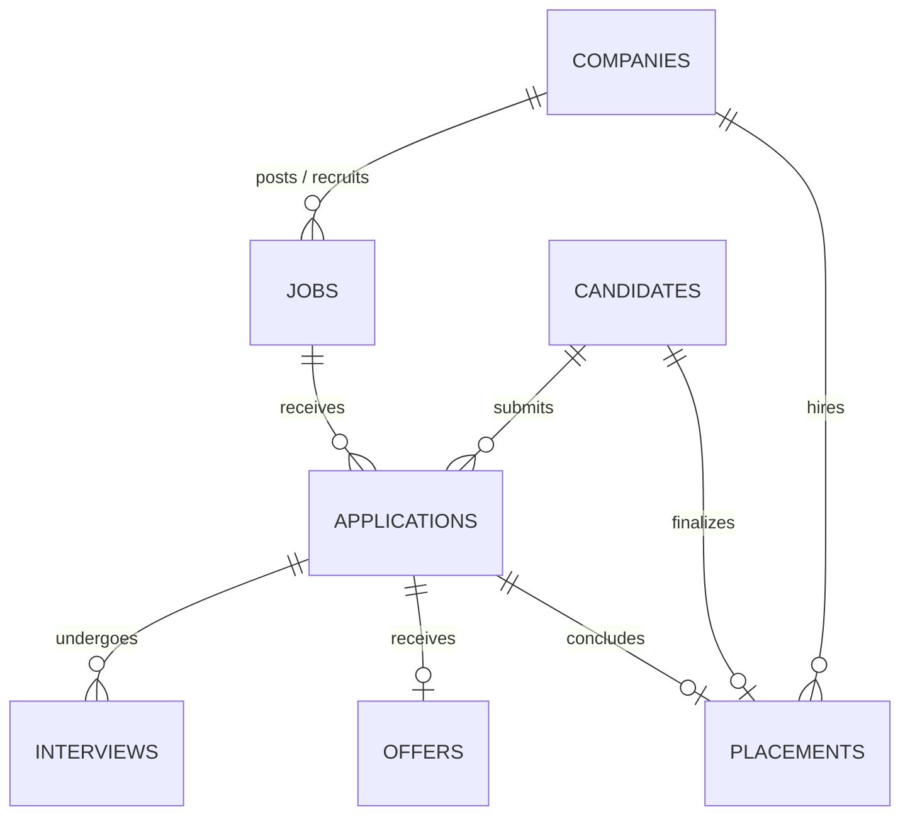

# Recruitment & Placement Management System (RPMS)
### Python Application Technical Specification — Student Version
**Kiran Academy &bull; Python + MySQL Architecture**

[](https://www.python.org/)
[](https://www.mysql.com/)
[](#2-system-architecture)
[-brightgreen.svg)](#8-automated-testing)

---

## 1. Project Overview

The **Recruitment & Placement Management System (RPMS)** is an industry-oriented console application designed to automate, streamline, and audit the full lifecycle of student recruitment and corporate placements. Built strictly adhering to the **Kiran Academy Student Version Technical Specification**, the system enforces clean Object-Oriented separation of concerns (`Model &rarr; DAO &rarr; Service &rarr; App`), strict validation constraints, parameterized SQL security, and a multi-stage recruitment workflow with state transition guarantees.

---

## 2. System Architecture

```text
Main Application (Console Menu / CLI)
             │
             ▼
       Service Layer (Business Logic & Workflow Rules)
             │
             ▼
         DAO Layer (Parameterized SQL Operations)
             │
             ▼
      MySQL Connector (Connection Management)
             │
             ▼
        MySQL Server (Relational Database)
```

- **Model Layer (`rpms/model/`):** Pure OOP dataclasses representing domain entities (`Candidate`, `Company`, `Job`, `Application`, `Interview`, `Offer`, `Placement`).
- **DAO Layer (`rpms/dao/`):** Executes parameterized queries (`%s`) preventing SQL injection. No user string concatenation.
- **Service Layer (`rpms/service/`):** Business logic, candidate eligibility assessment, duplicate application prevention, stage progression state machine, and activity logging.
- **App Layer (`rpms/app/`):** Interactive console interface with 9 menu options and ANSI table formatting.
- **Util Layer (`rpms/util/`):** Database connection pooling, input validators, ASCII table formatter, and activity logger.
- **Exception Layer (`rpms/exception/`):** Custom domain exceptions (`CandidateNotFoundError`, `JobNotFoundError`, `DuplicateApplicationError`, `CandidateNotEligibleError`, `InvalidWorkflowTransitionError`).

---

## 3. Project Structure

```text
AgentX/
├── rpms/
│   ├── app/
│   │   ├── __init__.py
│   │   └── menu.py                  # Interactive 9-option console menu
│   ├── dao/
│   │   ├── __init__.py
│   │   ├── candidate_dao.py         # Candidate parameterized queries
│   │   ├── company_dao.py           # Company parameterized queries
│   │   ├── job_dao.py               # Job management queries
│   │   ├── application_dao.py       # Application lifecycle queries
│   │   ├── interview_dao.py         # Interview scheduling & feedback queries
│   │   ├── offer_dao.py             # Offer issuance & tracking queries
│   │   ├── placement_dao.py         # Final placement queries
│   │   └── report_dao.py            # Statistical aggregation queries
│   ├── exception/
│   │   ├── __init__.py
│   │   └── exceptions.py            # Specification Section 11 exceptions
│   ├── model/
│   │   ├── __init__.py
│   │   ├── candidate.py             # Candidate model (percentage, backlogs)
│   │   ├── company.py               # Partner company model
│   │   ├── job.py                   # Job opening model
│   │   ├── application.py           # Application model
│   │   ├── interview.py             # Interview & ratings model
│   │   ├── offer.py                 # Offer model
│   │   └── placement.py             # Final placement model
│   ├── service/
│   │   ├── __init__.py
│   │   ├── candidate_service.py     # Candidate validation & CRUD logic
│   │   ├── company_service.py       # Company management logic
│   │   ├── job_service.py           # Job vacancy logic
│   │   ├── eligibility_service.py   # Multi-point eligibility engine (Sec 7)
│   │   ├── application_service.py   # Application submission & duplicate guard
│   │   ├── workflow_service.py      # Strict state transition machine (Sec 8)
│   │   └── report_service.py        # Analytics & collections (Sec 12 & 14)
│   └── util/
│       ├── __init__.py
│       ├── db_connection.py         # Managed MySQL connection context
│       ├── logger.py                # File handling (activity_log.txt)
│       ├── validators.py            # Email, phone, date, marks validators
│       └── table_formatter.py       # Styled ASCII table printer
├── sql/
│   ├── schema.sql                   # MySQL DDL table schemas & constraints
│   ├── seed_data.sql                # Realistic test seed data
│   ├── setup_db.py                  # Automated database setup tool
│   └── ER_DIAGRAM.md                # Entity-Relationship diagram specification
├── prototype/
│   ├── index.html                   # HTML5 interactive prototype
│   └── style.css                    # Responsive CSS3 styling
├── tests/
│   ├── test_rpms.py                 # Unit tests (models, validators, workflow)
│   └── test_dao_integration.py      # Live MySQL integration tests
├── activity_log.txt                 # Persistent activity event log (Sec 13)
├── main.py                          # Main application entry point
├── requirements.txt                 # Dependencies
├── SAMPLE_OUTPUT.md                 # Complete execution transcripts
└── README.md                        # Project documentation
```

---

## 4. Entity-Relationship (ER) Diagram



*For complete schema attribute definitions and relational cardinality, see [sql/ER_DIAGRAM.md](file:///c:/Users/karan/Desktop/AgentX/sql/ER_DIAGRAM.md).*

---

## 5. Recruitment Workflow State Machine

The recruitment workflow adheres strictly to Section 8 of the specification:

```text
               ┌─────────────┐
               │   APPLIED   │
               └──────┬──────┘
                      │
                      ▼
               ┌─────────────┐
               │ SHORTLISTED │
               └──────┬──────┘
                      │
                      ▼
               ┌─────────────┐
               │  INTERVIEW  │
               └──────┬──────┘
                      │
                      ▼
               ┌─────────────┐
               │  SELECTED   │
               └──────┬──────┘
                      │
                      ▼
               ┌─────────────┐
               │   OFFERED   │
               └──────┬──────┘
                      │
                      ▼
               ┌─────────────┐
               │   JOINED    │
               └─────────────┘
                      ▲
       (Alternative at any stage: REJECTED)
```

> **Invalid Direct Jump Protection:** Direct transitions such as `APPLIED &rarr; JOINED` or `SHORTLISTED &rarr; OFFERED` are strictly rejected by `RecruitmentWorkflowService` with `InvalidWorkflowTransitionError`.

---

## 6. Multi-Point Eligibility Rules (Section 7)

Before an application can be accepted, the `EligibilityService` verifies 7 conditions:
1. **Candidate is Active:** Deactivated accounts cannot apply.
2. **Job is Open:** Closed job postings reject new submissions.
3. **Valid Deadline:** `Current Date <= Job Deadline`.
4. **Duplicate Prevention:** Candidate cannot apply twice for the same job.
5. **Percentage Criteria:** `Candidate Percentage >= Job Minimum Percentage`.
6. **Passing Year Criteria:** `Candidate Passing Year == Job Target Year`.
7. **Backlog Criteria:** `Candidate Backlogs <= Job Maximum Backlogs`.

Result format: `ELIGIBLE` or `NOT ELIGIBLE: <detailed reasons>`.

---

## 7. Python Collections & Reports (Sections 12 & 14)

As specified in the technical requirement:
- `list[Candidate]` &mdash; Candidate rosters and unplaced lists.
- `list[Job]` &mdash; Active open jobs.
- `list[Application]` &mdash; Applications filtered by workflow status.
- `dict[str, int]` &mdash; Aggregations for technology counts, status counts, and company placements.

---

## 8. Setup & Execution Instructions

### Prerequisites
- Python 3.10+ (tested on Python 3.14)
- MySQL Server 8.0+

### Step 1: Configure Database Environment
Ensure `.env` in the root folder contains your MySQL connection credentials:
```ini
DB_HOST=localhost
DB_PORT=3306
DB_USER=root
DB_PASSWORD=YourPassword
DB_NAME=rpms_db
```

### Step 2: Initialize Database and Populate Seed Data
```bash
python sql/setup_db.py
```

### Step 3: Run the Console Application
```bash
python main.py
```

### Step 4: Run Automated Tests
```bash
pytest tests/
```

### Step 5: View the HTML/CSS Prototype
Open `prototype/index.html` in any web browser to view the interactive student portal, recruitment Kanban board, and analytics charts.

---

## 9. Deliverables Verification (Section 16 & 17)

| Deliverable | Location | Status |
|---|---|---|
| **Python Source Code** | `rpms/`, `main.py` | Completed (Modular OOP) |
| **MySQL Scripts** | `sql/schema.sql`, `sql/seed_data.sql`, `sql/setup_db.py` | Completed & Tested |
| **ER Diagram** | `sql/ER_DIAGRAM.md`, `README.md` | Completed (Mermaid + Table) |
| **HTML/CSS Prototype** | `prototype/index.html`, `prototype/style.css` | Completed & Interactive |
| **Test Cases** | `tests/test_rpms.py`, `tests/test_dao_integration.py` | 100% Passed (10/10) |
| **README** | `README.md` | Completed |
| **Sample Transcripts** | `SAMPLE_OUTPUT.md`, `activity_log.txt` | Completed |
